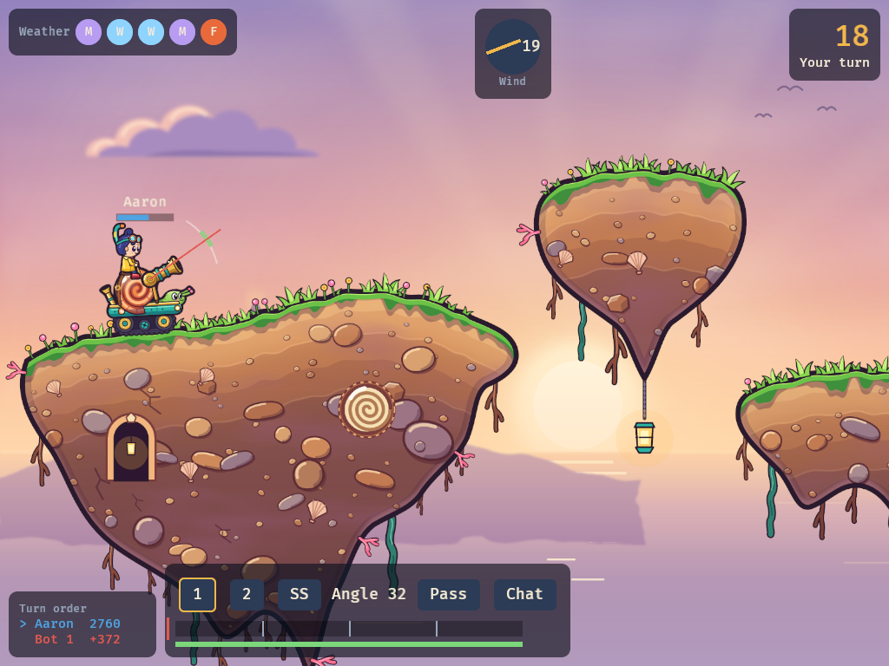

# lobshot

[](https://github.com/twitchax/lobshot/actions/workflows/build.yml)
[](https://codecov.io/gh/twitchax/lobshot)
[](LICENSE)

Turn-based artillery in the browser, in the spirit of GunBound: chunky mobiles, wind, delay-based
turn order and terrain you blow apart. No accounts and no lobbies: start a game, send the link.



Play it at **https://lobshot.twitchax.com**: start a room, send the link, and play Solo from 1v1
to 4v4 with friends or bots. Five mobiles, five maps with two variants each, all 11 items, sudden
death, and a slot machine for the dead. "Practice vs bot" plays offline. More mobiles, maps and
modes come next: [`DESIGN.md`](DESIGN.md) has the plan and the milestones, and `.prds/` tracks
each one.

## Self-hosting

One binary serves the client, the WebSocket and the rooms, so self-hosting is running the image:

```bash
docker run --rm -p 8080:8080 ghcr.io/twitchax/lobshot:latest
```

Then open http://localhost:8080. Rooms live in memory: a restart ends the games in progress.

## Development

```bash
cargo make dev       # a quick client bundle, then serve it on http://127.0.0.1:8080
cargo make art       # render assets/ (SVG art, plus the sounds) into assets/gen/; review sheets in target/art-preview/
cargo make dist      # the release bundle in dist/, precompressed
cargo make ci        # fmt-check + clippy (native and wasm32) + nextest + wasm32 replays + the balance gate: the gate CI runs
cargo make browser   # the browser smoke test: the release bundle in headless Chrome
cargo make uat       # ci + the release bundle + the #[ignore]d slow suites, the browser test included
cargo make balance   # every pair of mobiles, 1v1 between bots, on every map: the win-rate matrix
```

LLM agents play through the lab, one seat against the bots: `lobshot-lab mcp` is an MCP server for
any MCP client, and `lobshot-lab play` takes a turn a command. `docs/playtests/` has the how-to
and the report format.

Needs the toolchain from `rust-toolchain.toml` (rustup installs it), plus trunk and wasmtime
(`cargo make tools`). The browser test needs Chrome or Chromium installed.

## License

Code: [MIT](LICENSE). Art and other files in `assets/`: [CC0](assets/LICENSE). Sound effects by
[Kenney](https://www.kenney.nl), also CC0 ([credits](assets/sounds/CREDITS.md)).

lobshot is not affiliated with GunBound, Softnyx or DragonBound.
