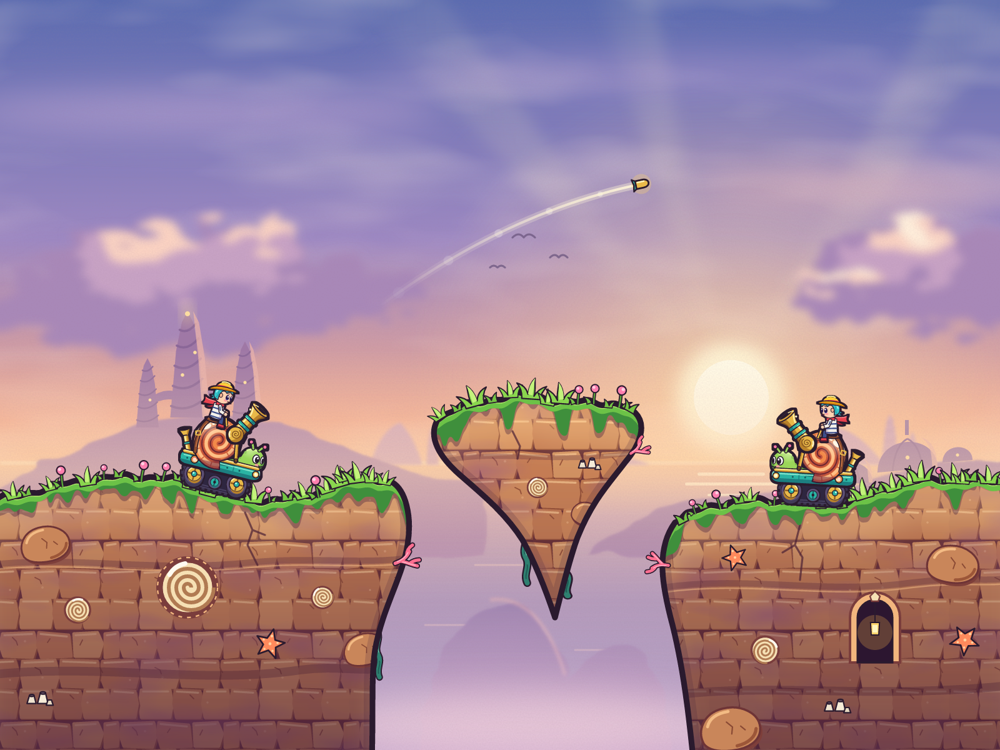

# Art spike: Coilback, Pip and Tidewall

One original mobile, rider and map slice, hand-authored as SVG and rasterized with `resvg`, to test
whether SVG could carry the art. It could: the pipeline is SVG throughout (`DESIGN.md`, "Art").

- **Coilback**, a snail-shell bell-mortar on treads, carries Armor's behavior. Its parts and cutout
  rig are in `assets/mobiles/coilback/`.
- **Pip**, a chibi kid in a sou'wester, is the first rider: `assets/riders/pip.svg`.
- **Tidewall** is the floating-islands map: `assets/maps/tidewall/`. `terrain.svg` and
  `terrain_mask.svg` are generated by `scripts/build_terrain.py` from one land path, so the art and
  the collision mask always agree.

`CHANGELOG.txt` records each refinement pass and what it fixed. `renders/` holds the review sheets:
the composite, the mobile's poses (2× and a 5× detail), the parts sheet and the 1× collision mask.

## Status of the scripts

`scripts/` holds the spike's Python as it ran: the rig composer (`compose.py`) and the terrain
builder (`build_terrain.py`). They expect the spike's layout (`mobile/coilback/`, `riders/`,
`maps/tidewall/` and `out/` beside `compose.py`), not `assets/`. M2 ports both to
`cargo xtask art` on the `resvg` crate, and then these become history.

## Known flaws, fixed in M2

Kept as a record. `cargo xtask art` (`xtask/src/art/`) fixed every one of these, and its tests guard
the ones a test can see: the rig checked against `sim::tuning`, the mask matching the land path, and
the cannon clear of the body at every aim.

- The terrain's stone tile visibly repeats.
- The rider is generic.
- The outline dilate leaves square corners at sharp joins.
- At 0° aim the cannon overlaps the antennae.
- `rig.ron` carries gameplay geometry (hitbox, muzzle, aim range, ground probes); it moves to
  `sim::tuning`, and a test checks the rig agrees.
- The collision mask must come from the land path only: decorations (grass tufts) fooled the
  spike's first ground probe.
- `resvg` does not render an `<image>` nested two levels deep.
- A 2× composite takes about 5 s to render.

Each additional mobile is about 1–2 hours of agent time plus review.
